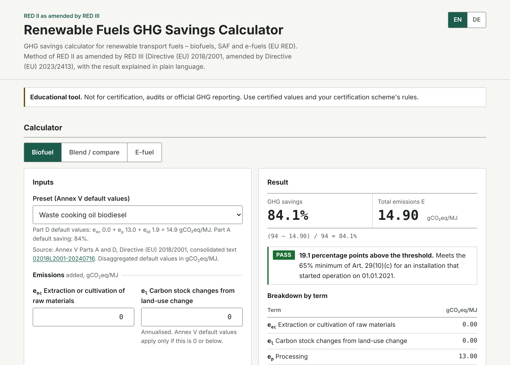

# Renewable Fuels GHG Savings Calculator

GHG savings calculator for renewable transport fuels – biofuels, SAF and e-fuels (EU RED).

A free web tool that calculates greenhouse gas savings under **RED II as amended by RED III** (Directive (EU) 2018/2001, amended by Directive (EU) 2023/2413) and explains the result in plain language.

It answers a question that comes up often: why can a fuel be 99% bio and save only 78%?

**Live tool:** https://red2-ghg-calculator.pages.dev



> **Educational tool. Not for certification, audits or official GHG reporting. Use certified values and your certification scheme's rules.**

## What it does

- **Biofuel (single pathway).** Enter the eight terms in gCO2eq/MJ, get total emissions E and the GHG savings. Results update as you type.
- **Threshold check.** Pass or fail against the minimum saving for transport biofuels, based on the date the installation started operation.
- **Blend / compare supplier offers.** Up to 5 components with energy amount (MJ) and E. Fossil components count as 94 gCO2eq/MJ. Output: saving of each component, energy-weighted intensity, blend savings and bio content by energy.
- **E-fuel (RFNBO / recycled carbon fuel).** E = ei + ep + etd + eu − eccs with the method of Commission Delegated Regulation (EU) 2023/1185, checked against the 70% minimum. No default values; user inputs only.
- **SAF.** No separate maths: bio-based SAF such as HEFA uses the biofuel method, synthetic aviation fuel uses the e-fuel method.
- **Presets.** Five Annex V default pathways.
- **Explainer.** Bio content versus GHG savings, and what each term means.
- **Chart.** Stacked contribution of each term against the fossil comparator line (94) and the threshold line, with exact values on hover, tap or keyboard focus.
- **Copy result, copy link, print.** Plain-text summary for notes or email, a shareable link that carries the inputs in the URL, and a one-page print layout.

- **Help tooltips.** A "?" next to every input, term, threshold and result label with one plain sentence, on hover, keyboard focus and tap.
- **English and German.** EN/DE toggle in the header. German browsers start in German; `?lang=de` or `?lang=en` in the link sets it explicitly.

No backend, no API keys, no tracking, no cookies. Everything runs in the browser.

## Method

All references are to the consolidated text of Directive (EU) 2018/2001 of 16.07.2024.

| Item | Rule | Source |
| --- | --- | --- |
| Total emissions | E = eec + el + ep + etd + eu − esca − eccs − eccr | Annex V Part C point 1(a) |
| Fossil fuel comparator | EF(t) = 94 gCO2eq/MJ | Annex V Part C point 19 |
| GHG savings | (94 − E) / 94 | Annex V Part C |
| Fuel in use | eu = 0 for biofuels | Annex V Part C point 13 |
| Soil carbon (esca) | Counts only with solid, verifiable evidence of increased soil carbon, no risk of harming biodiversity, and accounting for extra fertiliser or herbicide use | Annex V Part C point 6 as amended by RED III |
| E-fuel total emissions | E = ei + ep + etd + eu − eccs | Delegated Regulation (EU) 2023/1185, Annex |
| E-fuel minimum saving | 70% against 94 gCO2eq/MJ, so E ≤ 28.2 gCO2eq/MJ | RED and Delegated Regulation (EU) 2023/1185 |
| Blend | Energy-weighted average of the component intensities; fossil components at 94 | Arithmetic, for illustration |

### Minimum savings for transport biofuels, Art. 29(10)(a)–(c)

| Installation started operation | Minimum saving |
| --- | --- |
| On or before 05.10.2015 | 50% |
| 06.10.2015 to 31.12.2020 | 60% |
| From 01.01.2021 | 65% |

These were not changed by RED III. The 70% and 80% thresholds in Art. 29(10)(d)–(h) apply to electricity, heating and cooling from biomass fuels, not to transport biofuels.

### Presets

Disaggregated default values from Annex V Part D, in gCO2eq/MJ, with the default saving from Part A as a cross-check. A unit test per preset checks that the calculated saving, rounded to a whole percent, equals the Part A value.

| Pathway | eec | ep | etd | E total | Part A default saving |
| --- | ---: | ---: | ---: | ---: | ---: |
| Waste cooking oil biodiesel | 0 | 13.0 | 1.9 | 14.9 | 84% |
| Hydrotreated oil from waste cooking oil (HVO) | 0 | 14.3 | 1.7 | 16.0 | 83% |
| Rape seed biodiesel | 32.0 | 16.3 | 1.8 | 50.1 | 47% |
| Sugar beet ethanol (no biogas from slop, natural gas as process fuel in conventional boiler) | 9.6 | 26.3 | 2.3 | 38.2 | 59% |
| Sugar cane ethanol | 17.1 | 1.8 | 9.7 | 28.6 | 70% |

Annex V default values apply only without land-use change emissions (el ≤ 0). ETBE and TAEE take the value of the ethanol pathway used.

## Sources

> The e-fuel details are still being checked against EUR-Lex; see "To verify" in `PROGRESS.md`.

- Directive (EU) 2018/2001 (RED II) as amended by Directive (EU) 2023/2413 (RED III), consolidated text CELEX 02018L2001-20240716 (16.07.2024):
  https://eur-lex.europa.eu/legal-content/EN/TXT/HTML/?uri=CELEX:02018L2001-20240716
- Commission Delegated Regulation (EU) 2023/1185 (GHG methodology for RFNBO and recycled carbon fuels): https://eur-lex.europa.eu/eli/reg_del/2023/1185/oj
- Annex V Part A (default savings), Part C (methodology), Part D (disaggregated default values); Article 29(10) (thresholds).

## Disclaimer

Educational tool. Not for certification, audits or official GHG reporting. Use certified values and your certification scheme's rules.

## How to run

Requires Node.js 22 LTS or newer.

```bash
npm install
```

```bash
npm run dev
```

```bash
npm test
```

```bash
npm run build
```

`npm run build` type-checks and writes the static site to `dist/`. `npm run preview` serves that build locally.

## Deployment

Static site. Cloudflare Pages is connected to this repository: build command `npm run build`, output directory `dist`, production branch `main`. The same settings work for a Vercel import.

## Project layout

```
src/calc.ts      calculation module (pure functions, no DOM)
src/presets.ts   the five verified Annex V presets
src/terms.ts     structure of the eight terms
src/i18n.ts      all English and German texts
src/main.ts      UI wiring
src/style.css    styles
tests/           Vitest tests for the calculation module, presets and translations
```

## About

Built by Unaiz Ahmed Khan, chemical engineer in Berlin. Four years leading production and procurement at a renewable fuels producer, where he raised the GHG savings of the company's fuels to 78% (RED II methodology) by sourcing bio-based feedstocks. Environmental Protection Officer (TÜV Rheinland) and IPMA Level D certified project manager, both 2026.

[linkedin.com/in/unaizkhan](https://www.linkedin.com/in/unaizkhan) · [github.com/Unaiz16](https://github.com/Unaiz16)
